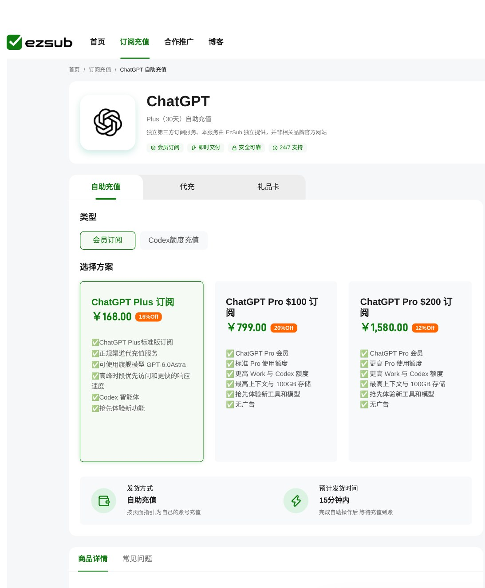
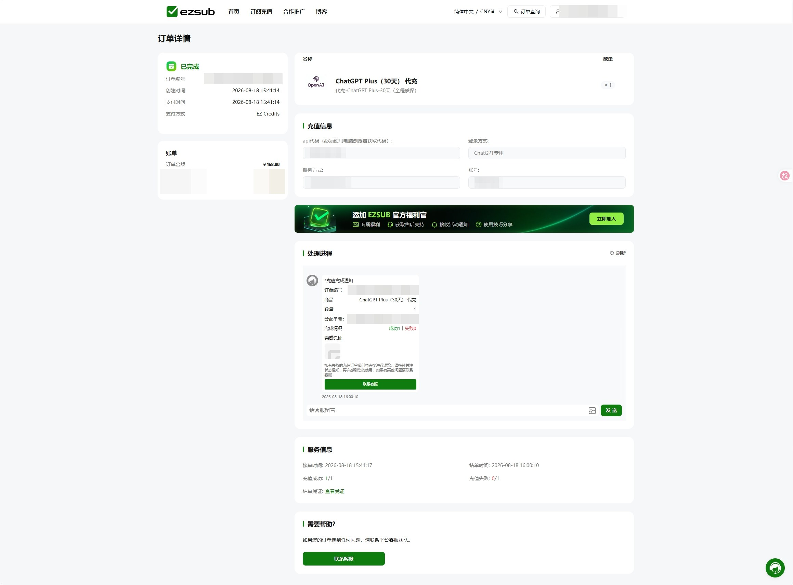

# ChatGPT充值教程（2026最新）｜国内支付宝/微信开通 Plus、Pro，自助充值到自己的账号

> 如对你有帮助，欢迎点一个 Star，本教程会持续更新。

## 一句话回答：国内没有海外信用卡，怎么充值 ChatGPT Plus？

打开 [EzSub 的 ChatGPT 自助充值页](https://www.ezsub.com/zh-cn/subscription/chatgpt-recharge)，选好 Plus 或 Pro 套餐，用支付宝/微信等人民币方式付款，再按页面提示复制并粘贴账号码验证，确认后提交即可，通常 15 分钟内到账，全程不需要账号密码，充的是你自己的账号。

## 关键信息一览

| 项目 | 说明 |
| --- | --- |
| 充值对象 | 你自己的 ChatGPT 账号（不是共享号、不是合租号），聊天记录全部保留 |
| 自助充值价（人民币） | Plus ¥168.00；Pro $100 ¥799.00；Pro $200 ¥1,580.00 |
| 人工代充价（人民币） | Plus ¥168.00；Pro $100 ¥799.00；Pro $200 ¥1,580.00；Pro $500 ¥3,688.00 |
| 付款方式 | 结算页支持支付宝/微信等人民币付款方式 |
| 到账时间 | 自助充值 15 分钟内；人工代充 5–60 分钟处理 |
| 会员有效期 | 1 个月 |
| 账号要求 | 充值要求账号当前没有生效中的订阅；已有 Plus/Pro 请等到期后再充 |
| 是否需要密码 | 不需要密码，不需要 2FA；只需要按流程复制账号码验证 |
| 发票 | 购买完成后，联系网站右下角客服开具 |
| Codex 点数 | 需要账号有生效订阅；点数长期有效、按量消耗，不包含会员 |

## 先分清两个概念：模型和订阅不是一回事

很多人第一次充值会把这两个混在一起：

- **订阅（Plus / Pro）**是你花钱买的东西，是会员身份，按月计费，决定你能用多少额度、能进哪些入口。
- **模型（GPT-6、GPT-5.6 等）**是会员身份下能调用的具体模型，开放范围由 OpenAI 决定，随时可能调整。

购买时只选 Plus 或 Pro 套餐。充值后能用哪些模型，要看 OpenAI 当时向该套餐和账号开放了什么。套餐选错了更麻烦，下单时别只看模型名字。先看下面「Plus / Pro 怎么选」，再决定买哪个套餐。

## 几种 ChatGPT 充值方法对比

| 方式 | 操作难度 | 账号掌控 | 付款方式 | 适合人群 | 建议 |
| --- | --- | --- | --- | --- | --- |
| EzSub 自助充值 | 低 | 自己的账号 | 支付宝/微信等人民币付款 | 没有海外卡、想省事、想快点到账 | 本文推荐，见下方详细步骤 |
| ChatGPT 官网直付 | 低 | 自己的账号 | 海外信用卡等官方支持的付款方式 | 已有合规可用的海外支付方式 | 有条件时最直接的选择 |
| 虚拟信用卡 | 高 | 自己的账号 | 虚拟卡 + 海外账单信息 | 熟悉海外支付、愿意自己折腾 | 谨慎尝试，注意开卡费与拒付风险 |
| App Store 内购 | 中 | 自己的账号 | Apple ID 地区对应的付款方式 | 苹果用户，熟悉 Apple ID 地区切换 | 可以考虑，注意礼品卡溢价与地区一致 |
| 共享账号/合租 | 低 | 不掌控账号 | 各卖家自定 | 只做无隐私内容的临时体验 | 不推荐，见下方说明 |

### 为什么不推荐共享账号

共享账号看起来最便宜，账号却不在你手里。别人能看到你的聊天记录。你上传的代码和文档也可能泄露，图片同样有风险。卖家随时可以改密码。多人异地登录容易触发验证或限制。账号出了问题也很难追责。只要涉及工作或学习资料，就不要用共享账号。也别用共享账号处理简历、合同和个人信息。EzSub 自助充值用的是你自己的账号，聊天记录和数据都在你自己手里。

## EzSub 自助充值详细步骤

完整图文版也可以看 EzSub 官方博客的[ChatGPT 自助充值图文教程](https://www.ezsub.com/zh-cn/blog/ezsub-chatgpt-self-recharge-tutorial)。下面是文字版流程：

### 准备工作

1. 在**电脑浏览器**上登录你要充值的 ChatGPT 账号，确认登录的是正确的账号。
2. 确认该账号当前**没有生效中的订阅**（Free 状态）。已有 Plus/Pro 的账号请等到期后再充，不要直接覆盖。
3. **关闭浏览器翻译功能**。翻译会改动页面内容，可能导致账号码复制不完整，这是最常见的失败原因。

### 充值流程

1. 打开 [ChatGPT 自助充值页](https://www.ezsub.com/zh-cn/subscription/chatgpt-recharge)，选择 Plus 或 Pro 套餐。
2. 在充值页点击**复制账号码**，按页面提示操作。
3. 回到已登录 ChatGPT 的浏览器，按提示**完整复制账号码**，不要只复制一部分，也不要手动输入。
4. 回到 EzSub 充值页，把账号码**粘贴到对应输入框并验证**。
5. 验证通过后，**仔细核对页面显示的账号和套餐**是否与你要充的一致。
6. 确认无误后提交，完成付款，等待到账。自助充值通常 15 分钟内完成。

### 提交后注意事项

- **提交后不能更换账号。** 提交前务必核对账号，提交后无法改成另一个账号。
- **不要重复提交。** 一笔订单提交一次即可，重复提交可能导致订单异常。
- **账号码只粘贴在该订单的 EzSub 充值页。**
- 充值成功后刷新 ChatGPT 页面，在账号的套餐（Plan / Subscription）页面确认已显示 Plus 或 Pro。

如果流程中遇到问题，先看本文档的 [支付失败与充值失败排查](./docs/chatgpt-payment-failed.md)，仍无法解决时联系 EzSub 客服，并提供订单号和截图。

真实订单示例：ChatGPT Plus（30 天）代充已完成，约 19 分钟处理完成（敏感信息已打码）。

## Plus / Pro 怎么选

| 套餐 | 自助价（人民币） | 适合谁 |
| --- | --- | --- |
| Plus | ¥168.00 / 月 | 日常问答、写作、翻译、轻量代码，每周集中用几次 |
| Pro $100 | ¥799.00 / 月 | 每天持续用 ChatGPT 或 Codex 做项目，Plus 额度经常不够 |
| Pro $200 | ¥1,580.00 / 月 | 高强度工作，Pro $100 仍在重置前耗尽 |
| Pro $500 | 人工代充 ¥3,688.00 / 月（自助页暂无此档） | 极高用量需求，先确认自己的实际消耗再买 |

几点提醒：

- 不确定用量时先买 Plus，用一段时间、看自己是否经常在重置前用完，再决定是否升级 Pro。
- Pro 的 $100、$200、$500 是三个不同的月费档位，不要把旧的倍数叫法（比如 5X、20X）直接当成现在的档位名称。
- 详细对比见 [ChatGPT Pro 充值教程｜100、200、500 档位怎么选](./docs/chatgpt-pro-recharge-guide.md)。
- Codex 点数是另一回事：它需要账号有生效订阅，长期有效、按量消耗，买点数不等于买会员。详见 [Codex 点数指南](./docs/codex-credits-guide.md)。

## 常见问题 FAQ

### 没有海外信用卡，怎么充值 ChatGPT Plus？

可以用 EzSub 自助充值：[打开 ChatGPT 自助充值页](https://www.ezsub.com/zh-cn/subscription/chatgpt-recharge)，选套餐后用结算页支持的支付宝/微信等人民币付款方式付款，再按流程复制账号码验证、确认提交即可，不需要海外信用卡。

### 充值需要把 ChatGPT 密码给客服吗？

不需要。EzSub 自助充值全程不需要密码和 2FA，只需要你本人按流程复制账号码并在订单页验证。

### 充到的是我自己的账号吗？

是。EzSub 自助充值升级的是你自己的 ChatGPT 账号，不是共享号、不是合租号，聊天记录全部保留。提交前请核对验证页显示的账号是否为你的账号。

### 账号码是什么？安全吗？

账号码是用来确认“要充哪个账号”的验证信息。你需要亲自在已登录 ChatGPT 的电脑浏览器上复制。它不是密码，只粘贴在该订单的 EzSub 充值页。

### 已有 Plus，还能继续充值吗？

充值要求账号当前没有生效中的订阅。已有 Plus/Pro 时，请等当前订阅到期后再充。直接覆盖可能让当前订阅的剩余时间失效，并从充值当天重新计算周期。

### 充值后多久到账？

自助充值通常 15 分钟内到账。人工代充的处理时间为 5–60 分钟。到账后刷新 ChatGPT 页面，在套餐页面确认状态。如果超过预计时间仍未到账，先看[充值失败排查](./docs/chatgpt-payment-failed.md)，再联系客服并提供订单号和截图。

### 充值失败怎么办？

最常见的失败原因之一是浏览器翻译没关，导致账号码复制不完整。账号已有生效订阅或重复提交也很常见。逐项排查方法见[支付失败与充值失败排查](./docs/chatgpt-payment-failed.md)。仍无法解决时联系 EzSub 客服，提供订单号和截图。

### 能不能开发票？

可以。购买完成后，联系网站右下角客服开具发票。

### Codex 能用吗？Codex 点数和会员有什么区别？

Plus/Pro 会员本身包含 Codex 入口。Codex 点数是单独的按量消耗额度：需要账号有生效订阅才能用，点数长期有效，买点数不等于买会员。详见 [Codex 点数指南](./docs/codex-credits-guide.md)。

### Pro 100、200、500 怎么选？

看用量：Plus 经常不够用时选 Pro $100。如果 Pro $100 的额度还是在重置前耗尽，再考虑 $200。$500 只适合用量特别高的用户。不要按旧的倍数叫法下单。详细对比见 [ChatGPT Pro 充值教程](./docs/chatgpt-pro-recharge-guide.md)。

### 付款方式有哪些？

结算页支持支付宝/微信等人民币付款方式。网站右上角可切换货币为人民币（CNY￥），价格以人民币显示（Plus ¥168.00，Pro $100 ¥799.00，Pro $200 ¥1,580.00）。

## 本仓库的其他教程

- [ChatGPT Plus 充值完整教程](./docs/chatgpt-recharge-guide.md)——Plus 充值从准备到确认到账的完整流程
- [ChatGPT Pro 充值教程｜100、200、500 档位怎么选](./docs/chatgpt-pro-recharge-guide.md)
- [ChatGPT 充值方法对比｜6 种付款路径怎么选](./docs/chatgpt-recharge-method.md)
- [Codex 点数指南｜点数和会员的区别](./docs/codex-credits-guide.md)
- [支付失败与充值失败排查](./docs/chatgpt-payment-failed.md)
- [Claude Pro 充值简版教程](./docs/claude-recharge-guide.md)

## 总结

在国内给 ChatGPT Plus/Pro 充值时，除了看价格，还要确认**充的是自己的账号，付款后能查订单**。再看**充值流程是否清楚，出了问题能不能找到客服**。

- 有合规可用的海外支付方式，优先官网直付；
- 没有海外卡、不想折腾虚拟卡，可以用 [EzSub 的 ChatGPT 自助充值](https://www.ezsub.com/zh-cn/subscription/chatgpt-recharge)，支付宝/微信付款，15 分钟内到账，全程不需要密码；
- 不要用共享账号处理任何隐私内容；
- 下单前核对账号与套餐，提交后不能换账号，不要重复提交。

👉 **[ChatGPT充值｜查看 Plus / Pro 自助套餐](https://www.ezsub.com/zh-cn/subscription/chatgpt-recharge)**

## 更新记录

- **2026-11-23｜人工代充价更新**：按简中人工代充页展示价更新（Plus ¥168.00、Pro $100 ¥799.00、Pro $200 ¥1,580.00；Pro $500 ¥3,688.00 不变）。
- **2026-11-23｜文案改写**：全文表述改写，降低 AI 生成痕迹；价格、流程、链接等事实内容不变。
- **2026-11-23｜仓库初版发布**：README 与 docs 下 6 篇教程上线。
