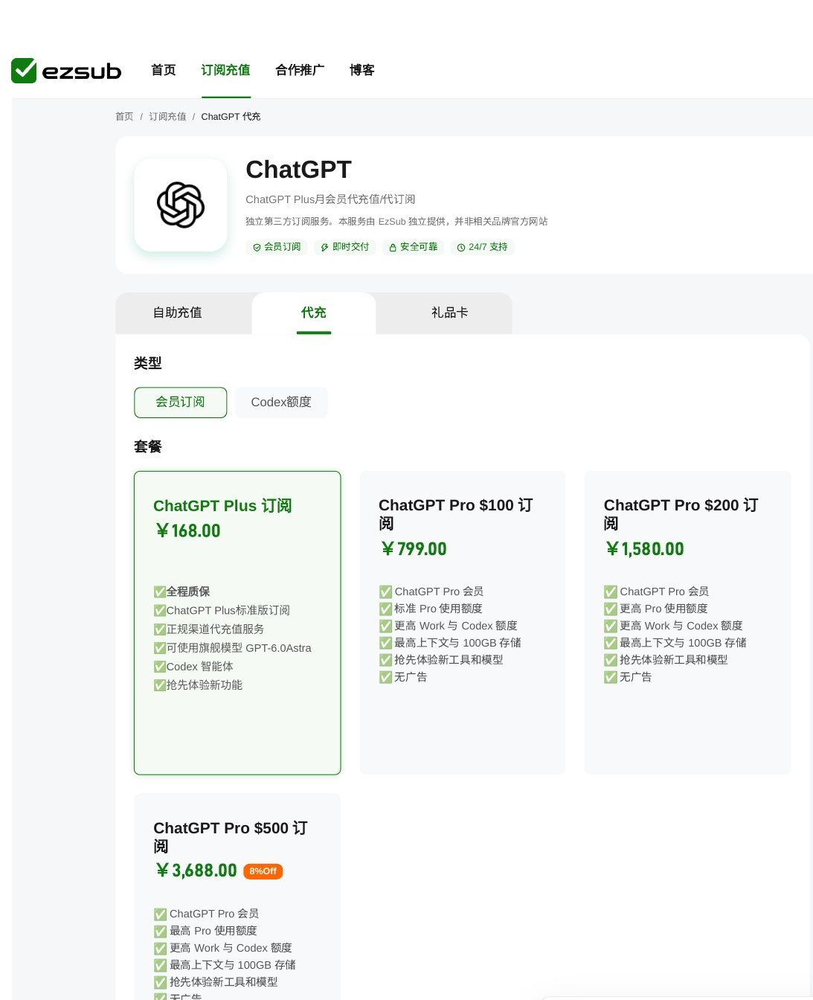

# ChatGPT Pro充值教程｜100、200、500档位与国内付款

## Pro 现在有几个档位？

ChatGPT Pro 目前有三个月费档位：**$100、$200、$500**。档位越高，月费越高，可用量度也越大。不要把旧的倍数叫法（比如 5X、20X）直接当成现在的档位名称。

## EzSub 价格

| 档位 | 自助充值 | 人工代充 | 到账时间 |
| --- | --- | --- | --- |
| Pro $100 | ¥799.00 | ¥799.00 | 自助 15 分钟内；人工 5–60 分钟 |
| Pro $200 | ¥1,580.00 | ¥1,580.00 | 自助 15 分钟内；人工 5–60 分钟 |
| Pro $500 | 自助页暂无此档 | ¥3,688.00 | 人工 5–60 分钟 |

会员有效期均为 1 个月。人工代充页：[ChatGPT Pro $500 人工代充](https://www.ezsub.com/zh-cn/subscription/chatgpt-top-up)。

## 什么时候值得从 Plus 升级到 Pro？

- Plus 额度经常在重置前用完，影响正常工作进度；
- 每天持续用 ChatGPT 或 Codex 处理代码、研究或长文档；
- 已经用 Plus 跑过一段时间，确认自己的用量确实超过 Plus 上限。

反过来，如果只是偶尔用 ChatGPT 问问题、写作或翻译，或者刚开始用，Plus 通常就够了。先买 Plus 试一个月，看实际消耗再决定，是最不容易浪费钱的办法。

## 三个档位怎么选？

| 情况 | 建议 |
| --- | --- |
| Plus 不够用，但不清楚自己到底需要多少 | 先选 Pro $100，用一个月看消耗 |
| Pro $100 仍在重置前反复耗尽 | 再看 Pro $200 |
| 极高用量，$200 也明显不够 | 考虑 Pro $500（仅人工代充），买之前先确认自己的实际消耗 |

用同一个模型时，提高 Pro 档位只会增加可用额度，回答质量不会随档位提高。

## Pro 充值流程

Pro 的自助充值流程与 Plus 相同：

1. 在电脑浏览器上登录要充值的 ChatGPT 账号，确认当前没有生效中的订阅。
2. 打开 [ChatGPT Pro 自助充值页（$100 / $200）](https://www.ezsub.com/zh-cn/subscription/chatgpt-recharge)，选择 Pro 档位。
3. 关闭浏览器翻译，按页面提示复制账号码并粘贴验证。
4. 核对账号与档位，确认提交。提交后不能换账号，不要重复提交。
5. 自助充值通常 15 分钟内到账，刷新 ChatGPT 在套餐页面确认。

Pro $500 目前只有人工代充，在人工代充页下单后按客服指引操作，处理时间 5–60 分钟。

## 已有 Plus，能直接充 Pro 吗？

充值要求账号当前没有生效中的订阅。已有 Plus 时，请等当前订阅到期后再充 Pro。直接覆盖可能让当前订阅的剩余时间失效，并从充值当天重新计算周期。

## Pro 与 Codex 点数的区别

Pro 会员本身包含 Codex 入口。Codex 点数是单独的额度，按量消耗，长期有效。账号有生效订阅才能用 Codex 点数，买点数也不等于买会员。如果你的问题是“Codex 额度用完了”，先看用完的是会员自带额度还是 Codex 点数，再决定买会员还是买点数。详见 [Codex 点数指南](./codex-credits-guide.md)。

## 常见问题

### Pro 买了之后能降回 Plus 吗？

会员到期后不续费 Pro，下个月重新买 Plus 即可。会员期内无法把 Pro 降级成 Plus 并退还差价。

### Pro $100 和 $200 的区别只是用量吗？

两档的主要区别是用量额度，档位越高，额度越多。具体额度与功能见 OpenAI 官方说明和账号实际显示。

### 付款方式有哪些？

结算页支持支付宝/微信等人民币付款方式。

### 能开发票吗？

可以。购买完成后，联系网站右下角客服开具。

## 相关教程

- [ChatGPT Plus 充值完整教程](./chatgpt-recharge-guide.md)
- [Codex 点数指南｜点数和会员的区别](./codex-credits-guide.md)
- [支付失败与充值失败排查](./chatgpt-payment-failed.md)
